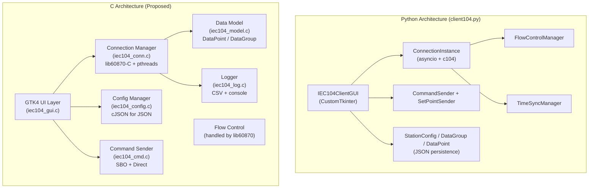
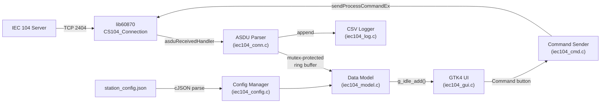

# IEC 104 Client: Python → C Migration with GTK4 UI

## 1. Architecture Comparison: Python vs C



### Migration Challenges

| Area | Python | C | Challenge |
|------|--------|---|-----------|
| **Memory** | GC automatic | Manual malloc/free | Must track lifetimes of DataPoint, DataGroup, config objects |
| **Async** | asyncio + threading | pthreads + mutexes | Replace `await asyncio.sleep()` with `pthread_cond_timedwait` |
| **GUI Threading** | `root.after(0, fn)` | `g_idle_add(fn, data)` | GTK4 must be updated from main thread only |
| **String Handling** | Dynamic strings | Fixed buffers + snprintf | All names, labels need bounded buffers |
| **JSON Config** | `json.loads/dumps` | cJSON library | Need manual parsing/building of JSON trees |
| **Callbacks** | Lambda/functools.partial | Function pointers + void* user_data | Design callback signatures with context |
| **Flow Control** | Custom FlowControlManager | **Built into lib60870** (k/w/t0-t3 APCI params) | Python's custom FC is unnecessary — lib60870 handles it natively |
| **Dynamic Types** | `any` value per point | Union type or [double](file:///c:/nexus-project/nexus-api/iiot_gateway_project/services/device_management/protocol/IEC104/example/read_write/agent/client104.py#3006-3012) + `int32_t` | Need a tagged union for point values |

> [!IMPORTANT]
> **lib60870 already handles** flow control (k/w/t0-t3), TESTFR, STARTDT/STOPDT, and reconnection internally via `CS104_Connection`. The Python [FlowControlManager](file:///c:/nexus-project/nexus-api/iiot_gateway_project/services/device_management/protocol/IEC104/example/read_write/agent/client104.py#760-885) class was custom-built for the [c104](file:///c:/nexus-project/nexus-api/iiot_gateway_project/services/device_management/protocol/IEC104/example/read_write/agent/client104.py#103-106) library — we do NOT need to reimplement it.

---

## 2. Data Flow Architecture



---

## 3. Project Structure

```
iec104-client-c/
├── CMakeLists.txt
├── src/
│   ├── main.c                  # GTK4 app init, command-line args
│   ├── iec104_types.h          # Enums, structs, constants (shared)
│   ├── iec104_model.h/.c       # DataPoint, DataGroup, Station (data model)
│   ├── iec104_config.h/.c      # JSON load/save via cJSON
│   ├── iec104_conn.h/.c        # Connection manager (lib60870 + pthread)
│   ├── iec104_cmd.h/.c         # Command sender (Direct + SBO)
│   ├── iec104_log.h/.c         # Console + CSV logging
│   └── iec104_gui.h/.c         # GTK4 UI (sidebar, grid, command panel, log)
├── lib/
│   ├── lib60870-C/             # (symlink or submodule)
│   └── cJSON/                  # cJSON single-file library
├── res/
│   ├── style.css               # GTK4 dark SCADA theme
│   └── app.gresource.xml       # GTK resource bundle
└── config/
    └── station_config.json     # Default config
```

---

## 4. Feature Mapping: Python → C

### A. Data Model (`iec104_model.h/.c`)

| Python Class | C Struct | Notes |
|---|---|---|
| [DataPoint](file:///c:/nexus-project/nexus-api/iiot_gateway_project/services/device_management/protocol/IEC104/example/read_write/agent/client104.py#111-151) | `IEC104_DataPoint` | `union { bool b; int32_t i; float f; uint32_t bits; } value;` |
| [DataGroup](file:///c:/nexus-project/nexus-api/iiot_gateway_project/services/device_management/protocol/IEC104/example/read_write/agent/client104.py#153-229) | `IEC104_DataGroup` | Fixed-size `points[]` array, [count](file:///c:/nexus-project/nexus-api/iiot_gateway_project/services/device_management/protocol/IEC104/example/read_write/agent/client104.py#3176-3220) field |
| [StationConfig](file:///c:/nexus-project/nexus-api/iiot_gateway_project/services/device_management/protocol/IEC104/example/read_write/agent/client104.py#231-404) | `IEC104_StationConfig` | `groups[]` array + connection params |
| [AsduType](file:///c:/nexus-project/nexus-api/iiot_gateway_project/services/device_management/protocol/IEC104/example/read_write/agent/client104.py#59-106) enum | `IEC104_AsduType` enum | Maps to lib60870 `TypeID` constants |

### B. Connection Manager (`iec104_conn.h/.c`)

| Python Feature | C Implementation |
|---|---|
| `ConnectionInstance.run_loop` | `pthread` worker thread calling `CS104_Connection_connect/sendStartDT` |
| Auto-reconnect loop | `while(running)` with `sleep` between retries |
| [FlowControlManager](file:///c:/nexus-project/nexus-api/iiot_gateway_project/services/device_management/protocol/IEC104/example/read_write/agent/client104.py#760-885) | **Not needed** — lib60870 APCI params handle k/w/t0-t3 |
| [TimeSyncManager](file:///c:/nexus-project/nexus-api/iiot_gateway_project/services/device_management/protocol/IEC104/example/read_write/agent/client104.py#984-1084) | Simple periodic `CS104_Connection_sendClockSyncCommand` in worker thread |
| [on_receive_point](file:///c:/nexus-project/nexus-api/iiot_gateway_project/services/device_management/protocol/IEC104/example/read_write/agent/client104.py#3688-3705) callback | `CS104_Connection_setASDUReceivedHandler` → parse → update model → `g_idle_add` |
| Multi-connection | Array of `IEC104_Connection` structs, each with own pthread |

### C. Command Sender (`iec104_cmd.h/.c`)

| Python Feature | C Implementation |
|---|---|
| `CommandSender.send_command_direct` | `CS104_Connection_sendProcessCommandEx(COT_ACTIVATION)` |
| `CommandSender.send_command_sbo` | Send with `select=true`, wait for ACT_CON, then send `select=false` |
| [SetPointSender](file:///c:/nexus-project/nexus-api/iiot_gateway_project/services/device_management/protocol/IEC104/example/read_write/agent/client104.py#1537-1782) | Normalized/Scaled/Short via `SetpointCommand*_create` |
| All 7 command families | SC, DC, RC, SE_NA, SE_NB, SE_NC + time-tagged variants |

### D. Config Manager (`iec104_config.h/.c`)

| Python Feature | C Implementation |
|---|---|
| `StationConfig.load_from_file` | cJSON parse → populate `IEC104_StationConfig` |
| `StationConfig.save_to_file` | Build cJSON tree → `cJSON_Print` → `fwrite` |
| Multi-connection format | `{"connections": [...]}` array |
| IOA overlap validation | Loop through groups checking ranges |

### E. GTK4 GUI (`iec104_gui.h/.c`)

| Python Widget | GTK4 Widget | Notes |
|---|---|---|
| `ctk.CTk` main window | `GtkApplicationWindow` | Dark theme via CSS |
| Toolbar buttons | `GtkHeaderBar` + `GtkButton` | Connect/Disconnect/GI/Sync/Edit |
| Sidebar group tree | `GtkTreeView` + `GtkTreeStore` | Connection roots → group children |
| Data points grid | `GtkColumnView` + `GListStore` | Sortable, filterable |
| Command control panel | `GtkStack` + `GtkBox` per family | SC/DC/RC/SE with buttons |
| Communication log | `GtkTextView` with tags | Color-coded by level |
| Traffic monitor | `GtkColumnView` | Timestamp/Dir/Type/IOA/Details |
| Status bar | `GtkBox` at bottom | Connection status pill + time |
| Edit Slave dialog | `GtkDialog` | Group rows with add/remove |
| New Connection dialog | `GtkDialog` | Name/IP/Port/COA fields |

### F. Logger (`iec104_log.h/.c`)

| Python Feature | C Implementation |
|---|---|
| Console logging | `printf` with timestamp + level prefix |
| CSV export | `fprintf` to file, comma-separated |
| Traffic buffer | Circular buffer of `TrafficEntry` structs |

---

## 5. Implementation Plan (Phases)

### Phase 1: Foundation (Core + Build)
- [ ] Set up CMakeLists.txt linking lib60870 + cJSON + GTK4 + pthreads
- [ ] Create `iec104_types.h` with all shared enums/structs
- [ ] Implement `iec104_model.c` (DataPoint, DataGroup, StationConfig)
- [ ] Implement `iec104_config.c` (JSON load/save)
- [ ] Unit test: load `station_config.json`, print parsed config

### Phase 2: Connection + Protocol
- [ ] Implement `iec104_conn.c` (connect, ASDU dispatcher, auto-reconnect)
- [ ] Implement ASDU received handler with full type coverage
- [ ] Implement periodic time sync
- [ ] Implement `iec104_cmd.c` (all command types, Direct + SBO)
- [ ] Implement `iec104_log.c` (console + CSV)
- [ ] Console-only test: connect, GI, receive data, send commands

### Phase 3: GTK4 UI — Main Window
- [ ] Create `main.c` with `GtkApplication`
- [ ] Dark SCADA CSS theme (`style.css`)
- [ ] Header bar with toolbar buttons
- [ ] Sidebar with connection tree
- [ ] Main data grid (`GtkColumnView`)
- [ ] Status bar with connection indicator

### Phase 4: GTK4 UI — Dialogs + Commands
- [ ] Command control panel (SC/DC/RC/SE families)
- [ ] Communication log panel
- [ ] Traffic monitor panel
- [ ] Edit Slave dialog
- [ ] New Connection dialog

### Phase 5: Integration + Polish
- [ ] Wire GTK4 to connection manager via `g_idle_add`
- [ ] Multi-connection support in sidebar
- [ ] Config save/reload
- [ ] CSV export from traffic log
- [ ] Full end-to-end testing with `simple_server`

---

## 6. Dependencies

| Library | Purpose | Source |
|---|---|---|
| **lib60870-C** | IEC 104 protocol | Already in project |
| **GTK4** | Cross-platform UI | `pacman -S mingw-w64-x86_64-gtk4` (MSYS2) |
| **cJSON** | JSON parsing | Single header+source from [github.com/DaveGamble/cJSON](https://github.com/DaveGamble/cJSON) |
| **pthreads** | Threading | Provided by MinGW/GCC |

## Verification Plan

### Phase 1–2 (Console)
- Build and run console client against `simple_server`
- Verify GI response parsing, command sending, auto-reconnect

### Phase 3–5 (GUI)
- Launch GTK4 app, verify dark theme renders
- Connect to server, verify data grid populates
- Send commands from panels, verify ACT_CON responses
- Test multi-connection with two server instances
